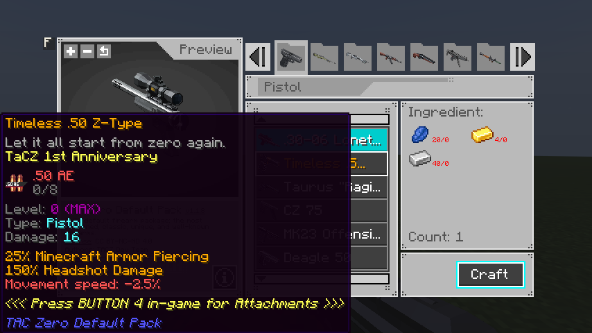
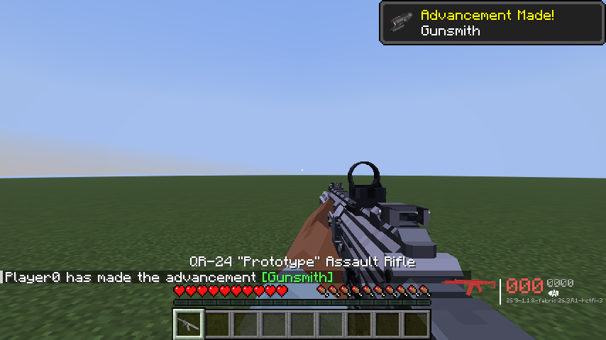
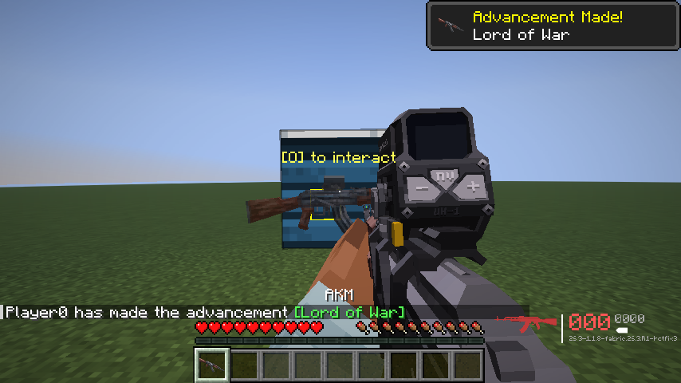
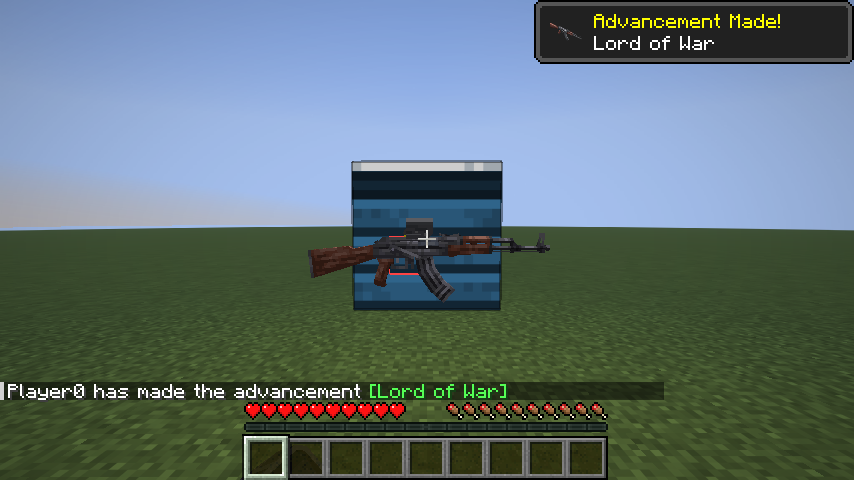
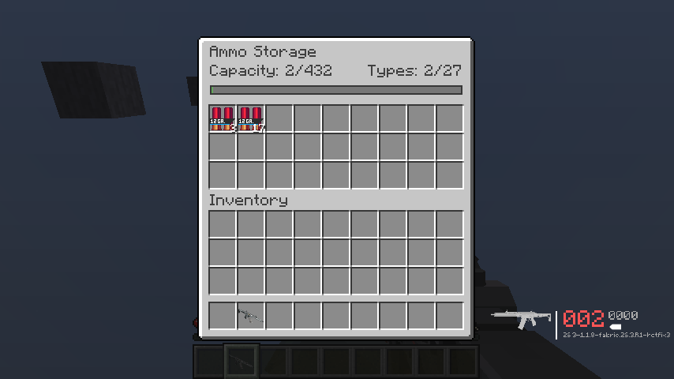
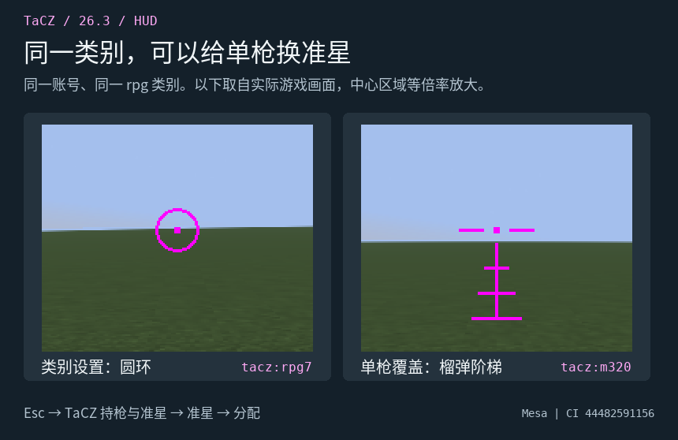
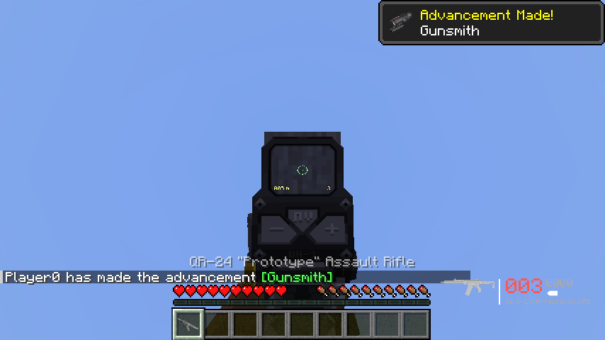
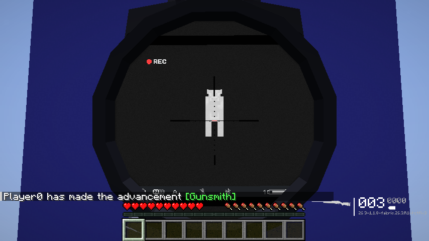
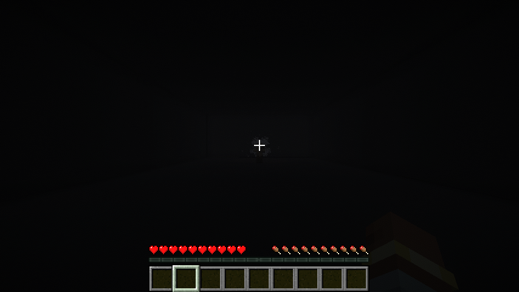
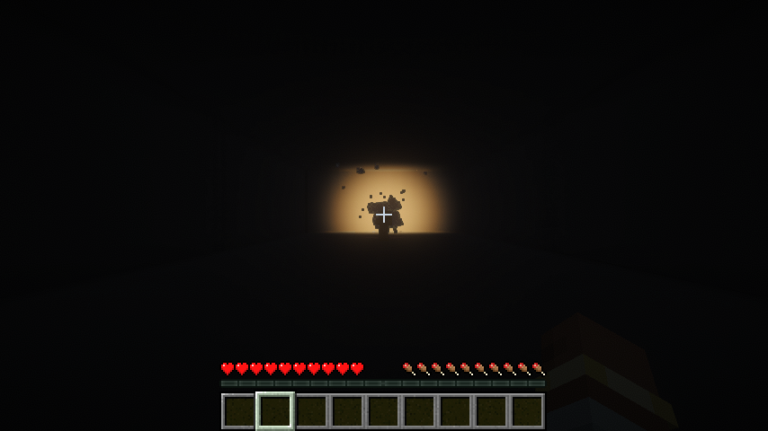

# 26.3 玩家指南：从第一张工作台到自己的展示墙

**适用文件：Minecraft 26.3 / Fabric，`1.2.0+fabric.26.3.R1` 测试构建。** 下文包含 [PR #124 的试玩版 `a14e06e3`](https://github.com/q14433686-arch/TaCZ_Refabricated_Unofficial/pull/124#issuecomment-7024035841)。已发布的 **1.1.8 R1-hotfix3** 没有这一整组功能；26.2、26.1.2、1.21.11 也各有自己的文件。先按[版本表](../README.md#选择你的-minecraft-版本--pick-your-minecraft-version)选对，再试下面的操作。

[实机截图图册 / Screenshot gallery](SCREENSHOTS_26_3.md) · [枪包作者 Wiki 补遗](wiki/GUNPACK_26_3.md) · [1.2.0 开发版变更清单](CHANGELOG_26_3_R1.md#120-r1)

## 做台子、找配方、装配件

1. **做第一张台子。** 进世界后取得一个铁块，在**原版 3×3 工作台**打开绿色配方书，找「枪械制造台」。铁块是**解锁条件**，不是整张配方。如果材料还没攒齐，关掉「仅可合成」就能先看配方。此版给本体的 20 个普通合成补了配方书解锁条件，包括弹药库升级。
2. **台子做出来后再查枪。** 空手使用对应的**枪械、配件或弹药工作台**。这三类专用配方不在绿色配方书里。持物打开却一片空白？先点「取消手持筛选」。JEI 或 REI 还能从枪查弹药／配件、从弹药／配件反查枪；「能搭配什么」不是「在哪张台子制作」。在创造栏可切换枪包、翻页或返回「全部」；精确射手步枪（DMR）也有自己的分类。
3. **试一把新枪。** 相比旧默认包，现在索引里有 **70 把枪、25 种弹药、126 个配件条目（含内置件）、5 个转接座**。例如 QR-24、M1897、M1866、PKM、SVD 和使用 `.300 BLK` 的 MCX Spear LT；部分旧枪的数据、装填或动画也有调整。不是每个索引条目都能单独合成。
4. **持枪按改装键（默认 Z）。** 先看枪允许哪些槽位。有些瞄具要先装兼容的增高座；拆时先摘镜，再拆必需的座。枪包指定的虚拟原厂件可以选，不会消耗或拆出一件背包物品。把鼠标移到配件上可看它实际声明的功能，例如测距、余弹显示，或枪焰与烟量的变化。

| 实际游戏画面 | 看哪里 |
|---|---|
|  | 中间是枪械制作列表，右侧是材料与数量；不是原版配方书。[筛选为空时](../build-reports/visual/44425974348-tacz_hand_filter_empty.png) |
|  | 改装完成后回到手持视角。想查用哪种弹？见 [JEI](../build-reports/visual/44234305280-tacz_viewer_jei.png) / [REI](../build-reports/visual/44234305280-tacz_viewer_rei.png) 的游戏内查询页。 |

**进服后才少配方，怎么报？** 先确认两端都更新。① 手摆也不出**台子**：查服务器数据包、材料标签及限制合成。② 手摆能做但书里没有：查解锁和配方书筛选。③ 书里有但 REI 消失：新版枪包晚到时只刷新自己的页面，保留服务器普通合成。④ 缺的是**台子里的枪／配件／弹药**：空手开对应台，或在 REI 查该物品的制作页。多包同名工作台过滤器不再互盖，只写黑名单也不会让客机整页变空；服主明确禁用的仍不会出现。报一个缺少的物品或配方 ID、哪一步失败，比只报总条数有用。见[分层排查与日志示例](investigations/ORDINARY_CRAFTING_26_3.md)。

## 弹药放哪里？收藏怎么挂？

- **铁 → 金 → 钻石弹药库。** 空手使用可看容量、种类、按弹种存取。拿已有弹种的普通弹药盒使用可补盒，潜行使用则将盒里的弹药存回。拿枪对准库按**持械交互键（默认 K）**，从库中取最多一组匹配弹药到背包，不是直接填满弹匣。升级和正常拆下再放置保留库存；同种弹药有名字等不同数据时不会被当成同一堆。
- **染色挂板与连片展示柜。** 不潜行，对准可用空格先看半透明预览；持枪按 **K**、普通展品用原版使用键，确认才放入一件。再用该格可旋转；生存中空手轻点攻击该格可取下。挂板可染色、接邻板或转角；面对同向连柜，空手潜行使用可一起锁／解锁。上锁或已占格时不会出现空位预览。

| 放之前：看得见背板 | 放之后：实物占用该格 | 弹药库：看容量与弹种 |
|---|---|---|
|  |  |  |

## 改自己的持枪位置和准星

手里拿枪，按 **Esc → 左下角「TaCZ 持枪与准星」**；不用装配置界面模组。位置页可上下、左右、前后移动第一人称枪模；开镜或改装时仍用枪包的位置。准星页可选内置图、资源包 PNG、自画线／点／框／环／阶梯，调尺寸、纵横比和颜色，在预览里试播开火。静态不动；动态围绕同一中心张开再回收，不改弹道或镜内分划。

例如只想让 M320 用阶梯：**准星 → 分配 → 指定单枪 → M320 → 选阶梯 → 保存**。同属 `rpg` 类的 RPG-7 仍跟随类别设置。优先级是**单枪 → 类别 → 本账号默认**；「移除覆盖」恢复继承，Esc 取消草稿。按启动器账号 UUID 保存在本机，换服不用重调。位置码 `TACZ-POS1:` 与准星码 `TACZ-HUD2:` 分开（准星还可读 HUD1，码不含 PNG）。[界面、可用分享码和三连发原帧](investigations/HUD_RETICLE_26_3.md)。

## 开镜、开火时会看到什么？

- **三个不同的镜内信息。** UH-1 的小数字读前方方块距离；XM157 可在可见实体处显示火控标记；XL50 热成像把未被墙挡住的合格实体显示为亮色，不是透视。MK5HD 等带读数的显示可用枪包定义的余弹文字，背包直读型供弹也能与 HUD 对应。组合镜依所选倍率使用实际镜片。默认经典变焦放大全屏；实验性**画中画（PIP）默认关**，开启后镜外可保持 1×。热源显示、镜片处理和 PIP 是不同开关。[开 PIP 的步骤和光影限制](../README.md#开启教程)。
- **火光不等于烟。** 新版 `renew` 枪焰跟着枪口，烟离开枪口留在场景里；第一人称、F5 或看到别的持枪实体时都可体现枪包设置。配件按数据改变焰的大小，不是一装上就一律熄灭。可以在「渲染」关 `RenderMuzzleSmoke` 而保留火光。枪包还可用动画触发 Snowstorm 粒子；曳光留在发射时的世界路径，转动视角不会让它拐弯。普通弹命中时可见方块材质碎屑；游戏内燃烧属性可显示熔岩粒子。命中碎屑、枪包额外烟尘和弹孔不是同一层。
- **光影画面。** Complementary Reimagined r5.9.3 的对照里，原包枪焰能保留白芯，暗处的手和枪仍保留自身颜色；SVD 手持、背挂和掉落有随物体移动的阴影，不必关掉实体阴影。[枪焰与投影原帧](investigations/REIMAGINED_26_3.md)。不是对所有 shader pack 或显卡的保证。

| UH-1：看镜内的小字 | XL50：只看镜内亮起的实体 |
|---|---|
|  |  |

### 在暗处试墙面和地面的补光

安装 Mod Menu 与 Cloth Config 时，从 **模组列表 → TaCZ → 齿轮 → 渲染** 开启；也可退出游戏编辑 `config/tacz-client.toml` 的 `[render]` 段。这三项互相独立，**默认全关**：

| 界面 / 配置键 | 在游戏里观察 |
|---|---|
| 枪口近场散射 `MuzzleSurfaceLight` | 在暗处距实心墙约 4–5 格，平举原包 AK 单发。看枪口**前方地面和左右墙面**，不只是脚下一点。新版枪和手本来就有的瞬时曝光不靠这个开关。 |
| 估算旧枪包击发曝光 `LegacyMuzzleLight` | 为旧贴图火焰或省略火焰声明的爆炸发射器补第一人称枪／手曝光；要看近墙还需开上一项。不会强行打开枪包明确关掉的火焰。 |
| 爆炸近场散射 `ExplosionSurfaceLight` | 原包 RPG-7 击中远墙时，看**实际爆点**两侧的墙和旁边地面短暂亮起，而不是发射者脚下。标准爆炸（也包括 TNT）和已识别的 LR 震撼弹按各自事件显示。 |

| RPG-7：关 | RPG-7：开 |
|---|---|
|  |  |

**两张都引爆了。** 这是客户端短暂照亮附近不透明方块表面的画法：没有光源方块，不改变刷怪、伤害、致盲或天空光；在没有接收面的空中不会出现灯球。**保留枪包原有镭射光束，只去掉额外画的落点**，不为镭射或曳光布灯。[原包 AK 与 RPG 的全部八张开／关原图](investigations/SURFACE_LIGHT_26_3.md#实际游戏帧不是效果图)。

### 地上远处的枪为什么变成图标？

玩家丢下的枪若**没有作者可用的低模（LOD）**，普通视角下默认从 **8 格**起用这把枪的槽位图标；走近仍看 3D。有作者低模仍沿用，没有槽位图则继续画 3D。只影响掉落物，图标不显示逐件配件；手持、挂板和展示框不会被换成平面。物品没有消失，拾取与服务器数据都不变。

在「渲染 → 无低模掉落枪图标距离」改 `DroppedGunSpriteDistance`：`0` 连脚边也用图标，`-1` 关闭回退。这不是隐藏物品，也不保证固定的帧率增益。[远处堆枪：保留 3D](../build-reports/visual/44627993715-tacz_dropped_guns_off.png) / [改用图标](../build-reports/visual/44627993715-tacz_dropped_guns_on.png)。两图是同一组 16 件掉落物；**青色方片是测试包故意选用的槽位图，不是默认枪的美术**。[适用条件与实测](investigations/DROPPED_GUN_LOD_26_3.md)。

## 操作、服务器规则与第三方枪包

| 想做什么 | 26.3 的做法或限制 |
|---|---|
| 改键、换弹和卸弹 | 在「选项 → 控制 → 按键绑定」改键盘或鼠标键；**R** 换弹，支持卸弹的枪用 **Alt + 当前换弹键**，或单独绑定「卸弹」。部分枪换弹会退出瞄准；部分脚本可分段装填或在背包内散热。26.3 的 **K** 取代会打开原版好友界面的 O；沿用旧键位要自己改。可选 Controllable 支持手柄动作与震动请求，测试用的是虚拟手柄。 |
| 趴下、反馈与世界规则 | 默认趴下键 **C**；服主可控制空手趴下、持枪趴姿视角和空中散布。某些枪包组合会推动角色本身；枪声可使附近符合条件的生物以玩家为目标，不是所有生物都会寻路到声源。服主可设同队无友伤时的穿过规则、免伤实体、能打碎的方块标签与硬度。普通受伤的视角倾斜、第三人称隐藏副手／未选中背挂枪是另两项客户端设置。可选 PAL 的第三人称持枪动作在角色离开视野后仍更新。 |
| 装枪包、升级或换服 | 文件夹或 ZIP 放 `.minecraft/tacz/`，包根放 `gunpack.meta.json`，只装可信包；服务端与客户端用匹配的构建和所需资源。兼容覆盖层随版本选择；进服／重载后重新同步配方和索引。若提示包声明的游戏版本不匹配，隐藏提示不会修好包。服主可先[只检查再导出一份兼容层](GUNPACK_CONVERSION_26_3.md)，不覆盖原包。`1.2.0` 不是 `=1.1.8`，通过版本检查也不是完整兼容证明。 |
| 选装附属 | 已内置 [TML 高模加载](MESH_LOADER.md)和部分 LRTactical 框架，不要再装旧游戏的 SimpleBedrockModel。需要 TacZ:Arcana 加密资源的包不支持；JEI、REI 分别测过，不等于 EMI、AR、Sable 或 Simulated 已支持 26.3。YSM 的端口边界见[兼容说明](YSM_COMPAT.md)。 |

**给服主：**要比较同款／异款枪的陈列开销，可以在空白测试存档里用 `/tacz debug pegboard 4 same`（或 `different`）生成实物挂板。它需要命令权限、会放置方块和物品，不是生存获取配方。[两种场景的实图](SCREENSHOTS_26_3.md#工作台收纳与陈列)。更新前备份存档与包；内置包重新导出的备份和手动转换的输出[不是同一目录](wiki/GUNPACK_26_3.md#先分清包的版本加载层同步数据)。

**出问题时**，到[本移植的问题区](https://github.com/q14433686-arch/TaCZ_Refabricated_Unofficial/issues)附 MC、模组完整文件名／测试提交、枪包、单人还是专服，以及最短复现步骤。画面问题请注明光影包、设置与同机位开／关截图。上游作者不负责本移植的支持。
