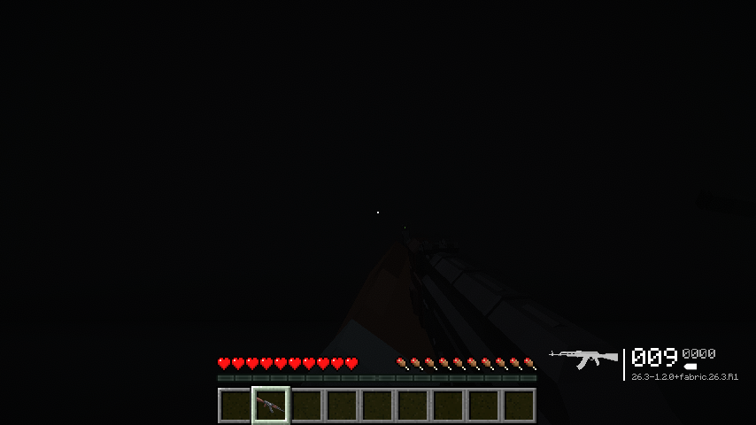
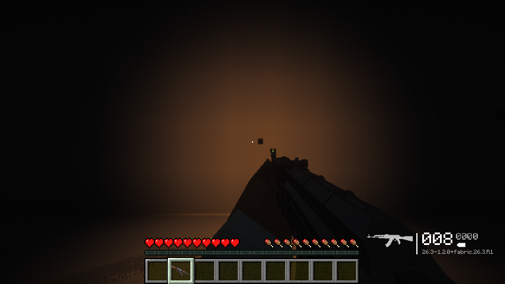
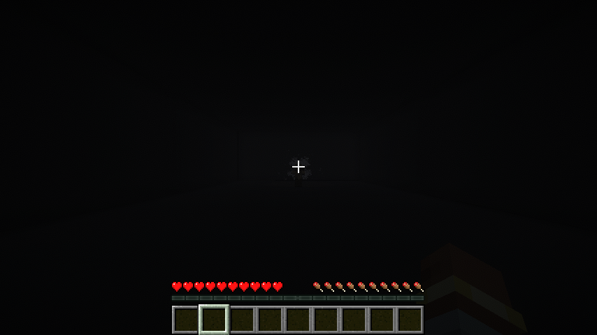
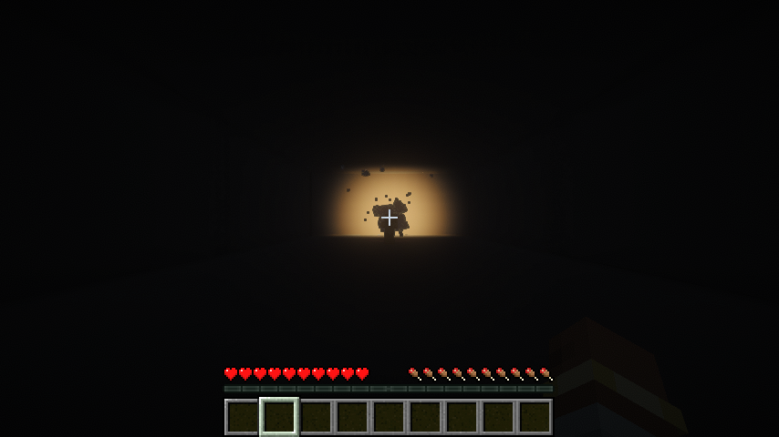

# 26.3 实机图册 · In-game gallery

这些画面来自运行 Minecraft 的 Fabric 测试客户端，不是效果图。**展示的是 26.3 开发线，不是旧 Release 的功能表。** 不同功能有各自的取景版本；早期帧仍有当时的 `1.1.8` 字样或不同的按键提示；当前新实例默认用 K 持枪交互。下表的链接打开仓库内原图，不用下载、登录或解压 CI 工件。

[玩家操作指南](PLAYER_GUIDE_26_3.md) · [本次开发构建的变更](CHANGELOG_26_3_R1.md#120-r1) · [全部留存截图，按主题展开（含对照和诊断）](../build-reports/visual/README.md)

## 工作台、收纳与陈列

| 图题 / Gallery title | 游戏截图 | 看什么 |
|---|---|---|
| 第一张工作台 / Inside the gunsmithing table | [没有匹配手持物](../build-reports/visual/44425974348-tacz_hand_filter_empty.png) → [取消筛选](../build-reports/visual/44425974348-tacz_hand_filter_cleared.png)；[试玩构建的列表与材料](../build-reports/visual/44627993715-tacz_hand_filter_cleared.png) | 清除手持筛选后能选回配方；图里是**专用台子**，不是原版配方书或服务端黑名单的截图。 |
| 这把枪用什么弹？ / Finding compatible ammunition | [JEI](../build-reports/visual/44234305280-tacz_viewer_jei.png) · [REI](../build-reports/visual/44234305280-tacz_viewer_rei.png) | 两次各只装一个查看器。`Gun Ammunition` 是枪包重载后的**用途查询页**，其中的新物品是测试包条目。 |
| 从改装回到手持 / QR-24 after refitting | [QR-24 与 Gunsmith 进度](../build-reports/visual/44417531060-tacz_default_refit.png) · [配件中文提示](../build-reports/visual/44432265461-tacz_hover_zh_cn_scope_xm157.png) / [English tooltip](../build-reports/visual/44432265461-tacz_hover_en_us_scope_xm157.png) | 前图是装配后的结果，不是改装菜单。后图在背包里悬停看镜片能力。 |
| 两种弹药库存 / Inside ammo storage | [弹药库菜单](../build-reports/visual/44363012970-tacz_ammo_storage_frame.png) | 两堆外观相似、数据不同的 12g 分开记录；上方显示容量及种类。 |
| 挂板与连柜 / Pegboard and display case | [展示墙](../build-reports/visual/44417531060-tacz_display_wall.png)；直板：[空](../build-reports/visual/44425974348-tacz_rack_empty.png) → [预览](../build-reports/visual/44425974348-tacz_rack_ghost.png) → [放入](../build-reports/visual/44425974348-tacz_rack_placed.png)；柜：[空](../build-reports/visual/44425974348-tacz_case_empty.png) → [预览](../build-reports/visual/44425974348-tacz_case_ghost.png) → [放入](../build-reports/visual/44425974348-tacz_case_placed.png) | 中间帧可透过物品看见背板；最后一帧才实际占格。拍的是解锁的柜子。 |
| 转角、普通物品与高模 / Corner and item previews | [折角预览](../build-reports/visual/44430716200-tacz_corner_ghost.png) / [实物](../build-reports/visual/44430716200-tacz_corner_placed.png)；[绿宝石](../build-reports/visual/44430716200-tacz_vanilla_quad_ghost.png)；[测试网格预览](../build-reports/visual/44434717131-tacz_mesh_ghost.png) / [实物](../build-reports/visual/44434717131-tacz_mesh_placed.png) | 比较同一格、同一视角；青色的纯网格是测试展品，不是随包武器。 |

**服主测试场景（不是生存配方）：** [64 件同款陈列](../build-reports/visual/44432265461-tacz_rack_load_same.png) / [64 件异款陈列](../build-reports/visual/44432265461-tacz_rack_load_different.png)。两图是管理员命令在空地生成的 16 块挂板，不是性能排行榜。

## 自己的视角与准星

| 图题 / Gallery title | 游戏截图 | 看什么 |
|---|---|---|
| 调持枪位置与配色 / View position and HUD designer | [默认位置](../build-reports/visual/44464116067-tacz_view_tuning_idle.png) / [移动后](../build-reports/visual/44464116067-tacz_view_tuning_moved.png) · [调色](../build-reports/visual/44469134375-tacz_view_tuning_colors.png) · [圆环编辑器](../build-reports/visual/44475620919-tacz_view_tuning_ring_editor.png) | 玩家在暂停菜单能进的编辑器。设置的是腰射 HUD，不是瞄具的分划。 |
| 开合的圆环 / One burst, three moments | [开火前](../build-reports/visual/44475620919-tacz_view_tuning_burst_rest.png) → [张开](../build-reports/visual/44475620919-tacz_view_tuning_burst_open.png) → [回收](../build-reports/visual/44475620919-tacz_view_tuning_burst_return.png)；[等倍率裁剪对照](../build-reports/visual/44475620919-hud-shot-comparison.png) | 本地三连发的视觉反馈。中心不动，不是子弹实际散布的截图。 |
| 同类两把枪，两副准星 / One category, two reticles | [M320 单枪分配页](../build-reports/visual/44482591156-tacz_view_tuning_m320_rule.png) · [M320 阶梯](../build-reports/visual/44482591156-tacz_view_tuning_m320_ladder.png) · [RPG-7 类别圆环](../build-reports/visual/44482591156-tacz_view_tuning_rpg7_type.png) · [中心裁剪并排](../build-reports/visual/44482591156-hud-rules.png) | 后者仍继承类别；这两条规则没有改变开镜位置、倍率或弹道。 |

## 看镜内、看枪口、看墙面

| 图题 / Gallery title | 游戏截图 | 看什么 |
|---|---|---|
| 测距与镜内标记 / Range display and impact marker | [UH-1 读数](../build-reports/visual/44627993715-tacz_range_readout.png)；XM157 [可见实体](../build-reports/visual/44233384724-tacz_xm157_restored.png) / [遮墙](../build-reports/visual/44233384724-tacz_xm157_occluded.png) | UH-1 显示镜内文字；XM157 的小黄空心框是镜内显示，不是镭射落点。 |
| 白热与遮挡 / XL50 thermal optic | 经典变焦：[光学](../build-reports/visual/44244608846-tacz_lens_classic_optical.png) / [热源](../build-reports/visual/44244608846-tacz_lens_classic_hot.png) / [墙后](../build-reports/visual/44244608846-tacz_lens_classic_wall.png)；PIP：[热源](../build-reports/visual/44244608846-tacz_lens_pip_hot.png) / [墙后](../build-reports/visual/44244608846-tacz_lens_pip_wall.png) | 同一测试场景，看镜片里实体轮廓与遮挡，不要用整个画面灰不灰来判断。 |
| 枪口焰与离开的烟 / Flash and detached smoke | [第一人称](../build-reports/visual/44350306969-tacz_muzzle_first.png) / [F5](../build-reports/visual/44350306969-tacz_muzzle_f5.png) / [关闭烟](../build-reports/visual/44350306969-tacz_muzzle_smoke_off.png)；[原包 Reimagined 夜间枪焰](../build-reports/visual/44455729177-reimagined-act-tacz_reimagined_night_stock.png) | 夜图为了抓到默认短寿命贴图，测试反复触发击发曝光；不是单发照亮墙面的证据。 |
| 试验服的配件与粒子对照 / Pack-authored particle tests | [裸枪开火](../build-reports/visual/44449218152-tacz_muzzle_marker_bare_on.png) / [装 RC1](../build-reports/visual/44449218152-tacz_muzzle_marker_rc1_on.png) · [Snowstorm 动画粒子](../build-reports/visual/44430716200-tacz_snowstorm_runtime.png) · 曳光[转身前](../build-reports/visual/44429872551-tacz_fired_tracer_before_turn.png) / [转身后](../build-reports/visual/44429872551-tacz_fired_tracer_after_turn.png) | 紫色方片是测试包的尺寸标记，不是 RC1 会把火焰染紫。材质、镜内裁剪及运动的其余对照见下方完整档案。 |

**枪口补光与爆点补光 / Surface light off and on.** 左右两列都实际开火。AK 看前墙左右与前方地面；RPG 看约 29.5 格外爆点旁的墙地，不是枪口或爆炸粒子本身。无光影与 Reimagined 的画面是**分别运行游戏采集**的；两个选项默认关闭。[场景、设置与测试提交](investigations/SURFACE_LIGHT_26_3.md)。

| 场景 / Scene | 关 / Off | 开 / On |
|---|---|---|
| 枪口 · 无光影 Vulkan | [AK OFF](../build-reports/visual/44626162907-tacz_surface_ak_off.png) | [AK ON](../build-reports/visual/44626162907-tacz_surface_ak_on.png) |
| 爆点 · 无光影 Vulkan | [RPG OFF](../build-reports/visual/44626162907-tacz_surface_rpg_off.png) | [RPG ON](../build-reports/visual/44626162907-tacz_surface_rpg_on.png) |
| 枪口 · Reimagined r5.9.3，ACT 128 |  |  |
| 爆点 · Reimagined r5.9.3，ACT 128 |  |  |

## 第三人称与地上的枪

| 图题 / Gallery title | 游戏截图 | 看什么 |
|---|---|---|
| 旁观者的持枪姿态 / Third-person poses with PAL | [步枪](../build-reports/visual/44440040072-tacz_pal_remote_rifle.png) / [手枪](../build-reports/visual/44440040072-tacz_pal_remote_pistol.png) | 可选 PAL 模组；画的是客户端里的测试角色，不是两台电脑联网的录像。 |
| 阳光中的枪影 / SVD shadow with Reimagined | [仍在背挂位](../build-reports/visual/44455729177-reimagined-act-tacz_reimagined_stowed.png) · [掉落](../build-reports/visual/44455729177-reimagined-off-tacz_reimagined_drop.png) / [物品移除后](../build-reports/visual/44455729177-reimagined-off-tacz_reimagined_removed.png) | 切空手不等于从快捷栏移除。白色平面是影子的接收面。 |
| 没有低模的掉落枪 / Distant guns without a pack LOD | [保留 3D（−1）](../build-reports/visual/44627993715-tacz_dropped_guns_off.png) / [用槽位图（8）](../build-reports/visual/44627993715-tacz_dropped_guns_on.png) | 同机位、同一组 16 件真实掉落物；最近约 12 格。青色图标特意用来辨认是否切换，不是默认槽位美术。 |

**出处与使用。** 图题可供项目 Gallery 填写；站点上传应使用所链 PNG，注明 *26.3 development*、有无光影，以及是否为测试包或裁剪对照。不把失败帧当成品图、不用平台下载链接作图床。游戏内默认枪包美术署名 **TACZ Dev Team，CC BY-NC-ND 4.0**；截图不改变原作、第三方模组或光影的许可。见[许可](../LICENSES.md)、[原帧与诊断索引](../build-reports/visual/README.md)。
