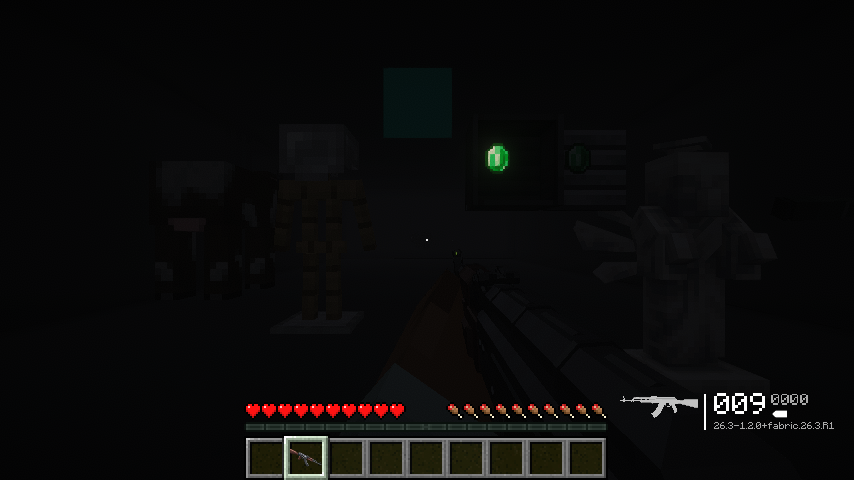
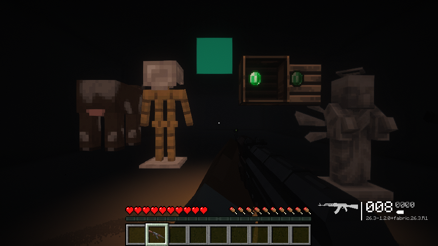
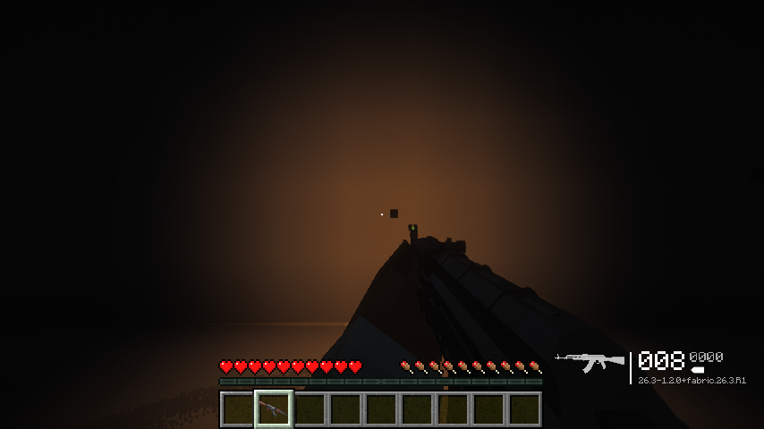

# 26.3：枪口与爆点的地形、实体和陈列物补光（实验）

这是**客户端可选的表面光效**，不是在世界里放光源。它不改变方块光、天空光、刷怪、伤害、致盲或其他玩家的设置；没有新增网络包、动态光依赖或默认枪包资源改动。

## 如何试

在客户端「渲染」页或 `config/tacz-client.toml` 开启相应选项。以下三项默认都是 `false`。

| 配置 | 建议对照 |
|---|---|
| `MuzzleSurfaceLight` | 暗处平举原包 AK，距前墙约 4–5 格开火。看前方地面和墙的两侧，而不只是枪口正下方或枪身。原有 `renew` 的枪和手曝光不依赖这个开关。 |
| `LegacyMuzzleLight` | 旧贴图枪和省略枪焰声明的爆炸类发射器可补第一人称**枪和手**曝光；若也要照地面，同时开 `MuzzleSurfaceLight`。不伪造枪焰粒子。 |
| `ExplosionSurfaceLight` | 让 RPG/榴弹击中约 30 格外的石墙，观察**爆点左右数格**或附近地面，与关闭此项对照。发射光是另一事件。LR 爆炸/粘性雷为暖光，能确认来源的震撼弹为短白光；不叠加一层全屏闪白。 |

**不再画额外的镭射命中点。** 原版枪包光束的颜色、长度、渐隐和提交路径不变；不在墙上另猜一个落点，也不沿镭射或曳光轨迹布灯。

## 配置优先于估算

新包不是按包版本、枪名或弹药伤害猜测。所用 display 的 `muzzle_flash.type: "renew"` 走[既有的效果解析](../../src/main/java/com/tacz/guns/client/particle/MuzzleEffectParameters.java)：`flash_light_level` 缺省 15、0 不补光；`scale`、当前视角的 `first_person_flash` / `third_person_flash`、枪口件 `flash_hider` 与消音回退仍然生效。枪械专属配件数据和内置/实装件仍由原路径决定。第一人称枪/手使用原来的 50 ms 窗口、天空光不变、暗处最多提高十级且不强压已有环境光。墙面效果不重复加在手上。

仅当用户允许**旧包估算**时：

- 对 `default` 或省略 `type` 的旧贴图火焰，先检查有贴图、有效正 `scale`、本视角未明确禁用火焰、没有有效消音。显式 `flash_light_level` 优先；否则取 `类别基准 × min(1.25, sqrt(scale))`。再乘枪口件 `flash_hider`，向上取整并限制在 0–15。基准取自游戏索引 `type`：pistol/smg 6，shotgun/sniper/mg 10，rpg 12，其余有旧贴图的枪 8。只改变曝光，不把旧四边形改成 Snowstorm。
- 没写整个 `muzzle_flash` 时，只有索引类别为 `rpg` **且**弹丸数据 `explosion.explode` 为真的发射器才用无定位骨回退（基准 12）。显式 `muzzle_flash: null`、有对象但缺贴图、零强度、普通无焰枪都不走这条路。不给烟雾或仅动画事件“猜”枪焰。
- 优先采用同射手、同枪/显示与当前视角最近一次的实际枪口定位（renew 包含配件偏移）。无可用定位才在射手眼位前方作保守估计，并沿眼位到枪口检测遮挡，避免长枪穿墙时把光放到墙背面。

## 为什么不再是枪口下的一块亮斑

- 不再仅沿六个世界轴找面，再贴固定半径的圆。现在在光照体积内由近到远查找真实的不透明整面，要求光源和观察者都在面前，并从**实际光源**检测到面心的遮挡。在每个方块的四个角按世界距离算亮度，相邻方块共用连续的衰减，而不是每块各画一个光斑。
- 枪口亮度峰在枪口，沿枪朝向延伸，侧面和后方也有较弱的光；不会把光源移到枪口前的墙后面。满强度范围前方约 **7.5 格**、侧方 **4.2 格**、后方约 **2.9 格**。面光峰值保持 28 ms，再平滑衰减，总长 **105 ms**。这不是更改枪/手曝光的 50 ms 窗口。
- 标准爆炸由已收到的爆炸包触发，球形范围 `clamp(4 + 1.5 × 包内半径, 6, 10)` 格，峰值保持 80 ms、总长 **320 ms**。贴墙/贴地命中在接触面的空气侧采样，不让贴着地面的射线误撞上一格；深埋在实体方块内的爆点不会被挪到观察者这面。若包报告破坏了方块，可在下一 tick 重新取一次接收面，不重置寿命。震撼弹为 6 格/175 ms。
- 标准爆炸通知有中心和半径，**没有来源实体 ID**：开启后 TNT 等标准爆炸也有光。LR 额外粒子不各算一盏灯；白光要求收到相应粒子束且附近确有已追踪的震撼弹。不以抛出、弹跳、烟雾、药水云或玩家的失明状态当作爆点。

## 开销与限制

枪口只考虑观察者 24 格内的射手；爆点则考虑 64 格内已收到的通知。每客户端合计最多四个活跃脉冲，**枪口最多两个**，同一射手新击发覆盖旧击发。眼位和枪口分别在同一空气格内、彼此不到一格且同向（约 15° 内）的枪口折为一次投影，优先本地或当前更亮者；不是把相隔几格的射手合并。仅共用世界面光，不减少击发、枪焰或枪身曝光。每游戏 tick 最多建面四次（含破坏地形后的重取），其中枪口最多两次。枪口每次最多 144 次面心遮挡检测，爆点最多 384 次；近面优先；预算切在半圈方块时，外圈衰减到零而不是留下阶梯状硬边。已建的几何缓存复用，衰减时只改顶点颜色；保留深度测试，不写深度、不重建区块，不在 PIP/阴影副场景画第二遍。光影下地形与自发光面可能有不同的亚像素抖动；以屏幕像素估计贴面间隙，世界单位封顶 0.092 格，不取消深度测试。

这是方块面粒度的近似，不是逐像素阴影、体积光或对所有模型的真实动态光。无遮挡的空气没有“灯球”；玻璃、半砖和任意复杂模型不充当实心整块地形接收面；实体和展架另走下述路径。复杂遮挡边缘或预算用尽时可能不连续。日光下增益较低，着色器也可能改变观感。大面积近墙绘制有填充成本，不承诺每台玩家显卡、每个光影的 P95 增量都低于 1 ms。

## 实体、装备和陈列物

**在暗处摆一副穿铁头盔的盔甲架，在普通挂板与展示柜内各放一颗绿宝石。** 同一机位切换 `MuzzleSurfaceLight` 各单发一次。应看到木架、头盔、板面和挂板物品一起受光，而展示柜里的宝石一直明亮；并非每个东西都统一加一层白色。

| Reimagined r5.9.3 / ACT 128 · 关 | 同一场景 · 开 |
|---|---|
|  |  |

原帧来自 [`a3847d0d` 通过的 ACT 128 作业](https://github.com/q14433686-arch/TaCZ_Refabricated_Unofficial/actions/runs/44639006524/job/135965003368)。**青色方片**是实际掉落的 TaCZ `ItemEntity` 使用的可辨色测试 `slot`，不是原包 AK 模型的外观。左侧是牛和穿铁盔的木架，右侧依次为展示柜、挂板与 TaCZ 雕像。两张都实际击发；对比世界物件，不是只看手上的枪。

**为什么以前只照地形：** 固体整面的投影不会命中盔甲架。26.3 的 `LevelRenderer.submitFeatures` 先提交实体和方块实体，Fabric 的 `COLLECT_SUBMITS` 在其返回时才运行。以前到这个时候才做补光，身体、装备和展品的绘制命令已记下原环境光。现在在提交前为主世界取一次时间和光源；[世界接收器](../../src/main/java/com/tacz/guns/client/render/light/WorldFlashFrame.java)按距离和方块遮挡只提高 `lightCoords` 的方块光分量，保留环境天光和原有更强的亮度，提交结束即恢复。**不是**全局改 lightmap，也不向服务端同步世界亮度。

挂板和柜体是区块里烘焙的多部件模型，不是渲染物品的方块实体。现在对[实际选中的模型面](../../src/main/java/com/tacz/guns/client/render/light/RackSurfaceLight.java)用原图集 UV、透明度、朝向和染色提亮；格内普通物品则从展示面取样。展示柜／发光挂板的内容和雕像手里的枪本来就用全亮值，**应保留**；雕像本体另受环境光。每帧世界物体（含格内物品）最多 96 次遮挡射线，柜／板外壳另限 16 架、96 次射线、每架扫描至多 256 个面。不生成区块更新，不给背包、PIP 或阴影副场景重复加光。

**量了什么：** [接收物用例](../../src/gametest/java/com/tacz/guns/test/ObjectLightSmoke.java)比的是同一物件表面的颜色，以及无遮挡静止、开关、过期和隔墙两帧；另在实际提交时[记录 UV2](../../src/gametest/java/com/tacz/guns/test/ReceiverInputs.java)。下面是 `a28882da` 同场景的 ON−OFF（8-bit 通道，不是方块光等级）。普通表面取红通道，绿宝石取绿通道，掉落物只取投影窗内青色核心的绿色中位数。上方 Reimagined 原图取于上一轮，相同 `src/main`。本轮[无光影原图：关](../../build-reports/visual/44640438182-tacz_surface_objects_off.png) / [开](../../build-reports/visual/44640438182-tacz_surface_objects_on.png)。

| 后端 | 牛 / 木架 / 铁盔 | 雕像 | 板面 / 柜背板 | 普通板宝石 / 全亮柜宝石 | 掉落物 |
|---|---:|---:|---:|---:|---:|
| [普通 Vulkan](https://github.com/q14433686-arch/TaCZ_Refabricated_Unofficial/actions/runs/44640438182/job/135969809591) | +26 / +84 / +85 | +45 | +64 / +27 | +71 / +1 | +87 |
| [Reimagined · ACT 关](https://github.com/q14433686-arch/TaCZ_Refabricated_Unofficial/actions/runs/44640438319/job/135969810515) | +21 / +87 / +86 | +26 | +34 / +8 | +45 / −2 | +84 |
| [Reimagined · ACT 128](https://github.com/q14433686-arch/TaCZ_Refabricated_Unofficial/actions/runs/44640438319/job/135969811061) | +28 / +92 / +90 | +28 | +35 / +7 | +46 / −1 | +85 |
| [简化 Iris 回归 shader](https://github.com/q14433686-arch/TaCZ_Refabricated_Unofficial/actions/runs/44640438319/job/135969811009) | 0 / +1 / 0 | −1 | +66 / +27 | −6 / +3 | 0 |

四次普通板格**实际提交**的方块光都是 **0 → 8 → 0**，柜内始终 `0xF000F0`，未改变天光。普通 Vulkan 和两种 Reimagined 中，所有物件的过期／隔墙像素差绝对值 ≤1。简化 shader 的普通实体材质不采 UV2，因此应当看到**板／柜外壳**的反射，但不能要求普通物件有同样像素增量，更不能把它当作真实光影表现。其物件过期／隔墙差绝对值 ≤6。隔墙测试使用受控发射者，不是第二位联网玩家。

早先 [`a3847d0d` 的简化 Iris 作业](https://github.com/q14433686-arch/TaCZ_Refabricated_Unofficial/actions/runs/44639006524/job/135965003705) 在 RPG 远墙对照报 `+35`，尚未跑到物体。回看[静止](https://github.com/q14433686-arch/TaCZ_Refabricated_Unofficial/blob/78f1f1bc/build-reports/visual/44639006524-tacz_surface_range_rest.png)与[旧过期帧](https://github.com/q14433686-arch/TaCZ_Refabricated_Unofficial/blob/78f1f1bc/build-reports/visual/44639006524-tacz_surface_blast_expired.png)，左侧墙上还有浅色粒子。现在原版粒子不关：早期到期帧比较同一片墙的逐点红通道差中位数，再等 100 tick 用**原均值门槛**查残光及背面。四个后端早期中位差都为 `[0,0,0]`；较晚的均值与背面在三个后端为零，ACT 128 为 `[0,1,0]`。不靠放松门槛、冻结时钟或改变正式渲染来过测。

### 有展品时的帧耗

同一暗室保留牛、戴盔木架、掉落物、雕像、两副架体和格内物品；在观察端重放 16 个近场击发输入，每源 600 RPM，按 **关 → 开 → 开 → 关**，每段 64 个 `renderFrame` 样本。用的是 CI 软件渲染；没有把 16 个模拟输入冒充 16 位联网玩家。

| 运行 | 完整帧 P95（按上述顺序，ms） | 两个开段的准备＋地形入队 P95（ms） |
|---|---|---|
| 普通 Vulkan（push） | 1.771 / 2.091 / 2.036 / 1.611 | 0.292 / 0.331 |
| [普通 Vulkan（PR）](https://github.com/q14433686-arch/TaCZ_Refabricated_Unofficial/actions/runs/44640444974/job/135969970072) | 3.383 / 3.970 / 3.255 / 2.871 | 0.433 / 0.439 |
| 简化 Iris / OpenGL | 13.919 / 18.298 / 14.550 / 13.137 | 0.305 / 0.304 |

小计时器只包住 `prepare` 和地形 `submit`，**不是**全部物体取光、架面收集、延后写顶点或 GPU 耗时。完整帧开关成本不恒定；简化 Iris 这里明显可能超过 1 ms。Reimagined 两档验了图像，**没在这两个作业上测这套 ABBA**。高模 VBO 的新光照档、密集陈列冷缓存和独显需另测。

### 还有哪些受光路径只是源码接通？

- 弹药库使用普通实心 `MODEL` 方块；专用台、雕像、标靶的方块渲染形态是 `INVISIBLE`，靠方块实体绘制。普通台和标靶把 `state.lightCoords` 传给模型，标靶矿车的自定义内容也消费传入亮度。**这几种 TaCZ 模型之中，本轮给雕像头部做了独立像素验收；不能据此替工作台、标靶、矿车或弹药库逐项打勾。**
- 普通物品展示框的物品使用实体亮度；原版发光展示框会给内容覆盖全亮值。普通 3D TaCZ 枪从 `TaczDynamicItemModel` 经 `GunItemRendererWrapper` 传入 Bedrock 快照；适用的 TML 世界 VBO 按量化的光照档取用／烘焙。不能用青色掉落图标或绿宝石的帧证明每一种第三方网格、材质、远距 LOD 都相同。
- 实体取代表点，不是逐肢体软阴影；挡光用方块碰撞体，不是实体之间互投阴影。不覆盖不消费世界光照的自定义 renderer。实体正例是原包枪口；爆点用同一接收帧，但远端 RPG 的专项像素测量是墙和地面，不是另做了一套逐物体验收。

## 实际游戏帧（不是效果图）

下表是单发对照：两次都真的开火/引爆，只切对应的表面补光开关。来自 [`a2f53dda` 的 Reimagined r5.9.3 / ACT 128 实跑](https://github.com/q14433686-arch/TaCZ_Refabricated_Unofficial/actions/runs/44626162782/job/135920451205)；后续多人重叠去重不改变单发的范围与强度。点击图片可看原尺寸。注意远端镜头中爆心左右的**墙**，不是只看准星上的爆炸粒子。

|场景|关闭补光|开启补光|
|---|---|---|
|原包 AK，平举、近墙|||
|原包 RPG-7，观察者距爆心约 29.5 格|||

同场景普通 Vulkan 原帧：AK [关](../../build-reports/visual/44626162907-tacz_surface_ak_off.png) / [开](../../build-reports/visual/44626162907-tacz_surface_ak_on.png)，RPG [关](../../build-reports/visual/44626162907-tacz_surface_rpg_off.png) / [开](../../build-reports/visual/44626162907-tacz_surface_rpg_on.png)。

## 验证入口

[场景与断言](../../src/gametest/java/com/tacz/guns/test/SurfaceLightSmoke.java) / [实际帧读回与世界坐标采样](../../src/gametest/java/com/tacz/guns/test/SurfaceLightFrames.java)：实装原包 AK 的两次扣扳机、在镜头内击中远墙的两次原包 RPG-7、对应开/关帧、到期帧和墙背面负例。对照区域在前方地面和墙上，排除准星、枪本身及爆炸粒子核心。**不冻结脉冲时钟**。另跑 LR 包分类及 16 个观察端击发输入的 ABBA 帧耗（不是 16 个联网玩家）；[旧包单测](../../src/test/java/com/tacz/guns/client/particle/LegacyShotLightTest.java)、[实际配件与视模回归](../../src/gametest/java/com/tacz/guns/test/MuzzleEffectsSmoke.java)独立运行。具体构建、截图与实测数据见 [PR #124](https://github.com/q14433686-arch/TaCZ_Refabricated_Unofficial/pull/124) 中**对应提交**的记录；早期中央墙面/青色像素计数不是本版的视觉验收。
