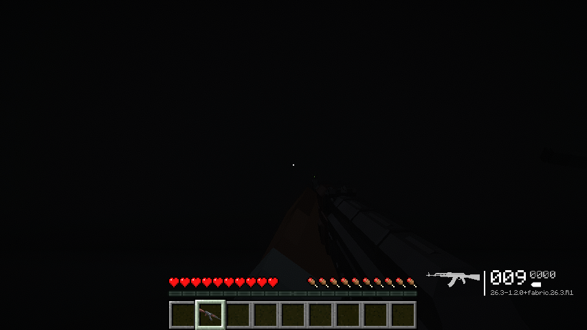
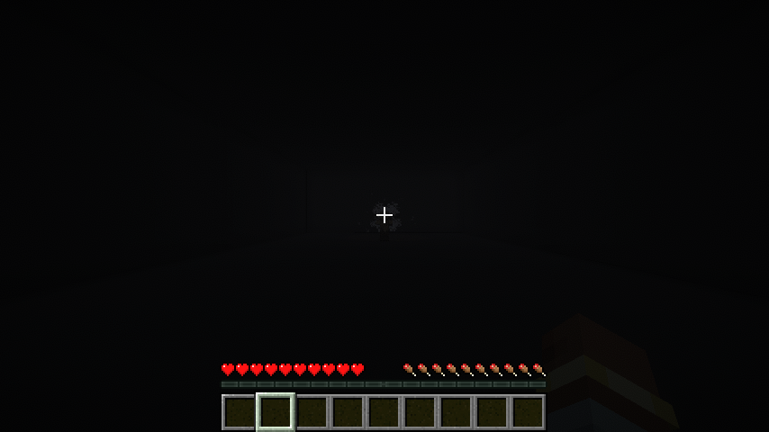
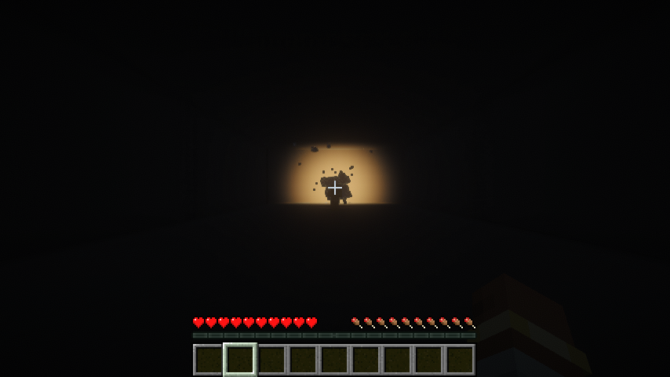

# 26.3：枪口与爆点的地面、墙面补光（实验）

这是**客户端可选的表面光效**，不是在世界里放光源。它不改变方块光、天空光、刷怪、伤害、致盲或其他玩家的设置；没有新增网络包、动态光依赖或默认枪包资源改动。

## 如何试

在客户端「渲染」页或 `config/tacz-client.toml` 开启相应选项。以下三项默认都是 `false`。

| 配置 | 建议对照 |
|---|---|
| `MuzzleSurfaceLight` | 暗处平举原包 AK，距前墙约 4–5 格开火。看前方地面和墙的两侧，而不只是枪口正下方或枪身。原有 `renew` 的枪和手曝光不依赖这个开关。 |
| `LegacyMuzzleLight` | 旧贴图枪和省略枪焰声明的爆炸类发射器可补第一人称**枪和手**曝光；若也要照地面，同时开 `MuzzleSurfaceLight`。不伪造枪焰粒子。 |
| `ExplosionSurfaceLight` | 让 RPG/榴弹击中约 30 格外的石墙，观察**爆点左右数格**或附近地面，与关闭此项对照。发射光是另一事件。LR 爆炸/粘性雷为暖光，能确认来源的震撼弹为短白光；不叠加一层全屏闪白。 |

**不再画额外的镭射命中点。** 原版枪包光束的颜色、长度、渐隐和提交路径不变；不在墙上另猜一个落点，也不沿镭射或曳光轨迹布灯。

## 配置优先于估算

新包不是按包版本、枪名或弹药伤害猜测。所用 display 的 `muzzle_flash.type: "renew"` 走[既有的效果解析](../../src/main/java/com/tacz/guns/client/particle/MuzzleEffectParameters.java)：`flash_light_level` 缺省 15、0 不补光；`scale`、当前视角的 `first_person_flash` / `third_person_flash`、枪口件 `flash_hider` 与消音回退仍然生效。枪械专属配件数据和内置/实装件仍由原路径决定。第一人称枪/手使用原来的 50 ms 窗口、天空光不变、暗处最多提高十级且不强压已有环境光。墙面效果不重复加在手上。

仅当用户允许**旧包估算**时：

- 对 `default` 或省略 `type` 的旧贴图火焰，先检查有贴图、有效正 `scale`、本视角未明确禁用火焰、没有有效消音。显式 `flash_light_level` 优先；否则取 `类别基准 × min(1.25, sqrt(scale))`。再乘枪口件 `flash_hider`，向上取整并限制在 0–15。基准取自游戏索引 `type`：pistol/smg 6，shotgun/sniper/mg 10，rpg 12，其余有旧贴图的枪 8。只改变曝光，不把旧四边形改成 Snowstorm。
- 没写整个 `muzzle_flash` 时，只有索引类别为 `rpg` **且**弹丸数据 `explosion.explode` 为真的发射器才用无定位骨回退（基准 12）。显式 `muzzle_flash: null`、有对象但缺贴图、零强度、普通无焰枪都不走这条路。不给烟雾或仅动画事件“猜”枪焰。
- 优先采用同射手、同枪/显示与当前视角最近一次的实际枪口定位（renew 包含配件偏移）。无可用定位才在射手眼位前方作保守估计，并沿眼位到枪口检测遮挡，避免长枪穿墙时把光放到墙背面。

## 为什么不再是枪口下的一块亮斑

- 不再仅沿六个世界轴找面，再贴固定半径的圆。现在在光照体积内由近到远查找真实的不透明整面，要求光源和观察者都在面前，并从**实际光源**检测到面心的遮挡。在每个方块的四个角按世界距离算亮度，相邻方块共用连续的衰减，而不是每块各画一个光斑。
- 枪口亮度峰在枪口，沿枪朝向延伸，侧面和后方也有较弱的光；不会把光源移到枪口前的墙后面。满强度范围前方约 **7.5 格**、侧方 **4.2 格**、后方约 **2.9 格**。面光峰值保持 28 ms，再平滑衰减，总长 **105 ms**。这不是更改枪/手曝光的 50 ms 窗口。
- 标准爆炸由已收到的爆炸包触发，球形范围 `clamp(4 + 1.5 × 包内半径, 6, 10)` 格，峰值保持 80 ms、总长 **320 ms**。贴墙/贴地命中在接触面的空气侧采样，不让贴着地面的射线误撞上一格；深埋在实体方块内的爆点不会被挪到观察者这面。若包报告破坏了方块，可在下一 tick 重新取一次接收面，不重置寿命。震撼弹为 6 格/175 ms。
- 标准爆炸通知有中心和半径，**没有来源实体 ID**：开启后 TNT 等标准爆炸也有光。LR 额外粒子不各算一盏灯；白光要求收到相应粒子束且附近确有已追踪的震撼弹。不以抛出、弹跳、烟雾、药水云或玩家的失明状态当作爆点。

## 开销与限制

枪口只考虑观察者 24 格内的射手；爆点则考虑 64 格内已收到的通知。每客户端合计最多四个活跃脉冲，**枪口最多两个**，同一射手新击发覆盖旧击发。眼位和枪口分别在同一空气格内、彼此不到一格且同向（约 15° 内）的枪口折为一次投影，优先本地或当前更亮者；不是把相隔几格的射手合并。仅共用世界面光，不减少击发、枪焰或枪身曝光。每游戏 tick 最多建面四次（含破坏地形后的重取），其中枪口最多两次。枪口每次最多 144 次面心遮挡检测，爆点最多 384 次；近面优先；预算切在半圈方块时，外圈衰减到零而不是留下阶梯状硬边。已建的几何缓存复用，衰减时只改顶点颜色；保留深度测试，不写深度、不重建区块，不在 PIP/阴影副场景画第二遍。光影下地形与自发光面可能有不同的亚像素抖动；以屏幕像素估计贴面间隙，世界单位封顶 0.092 格，不取消深度测试。

这是方块面粒度的近似，不是逐像素阴影、体积光或对所有模型的真实动态光。无遮挡的空气没有“灯球”；玻璃、半砖、实体和复杂模型不充当实心整块接收面。复杂遮挡边缘或预算用尽时可能不连续。日光下增益较低，着色器也可能改变观感。大面积近墙绘制有填充成本，不承诺每台玩家显卡、每个光影的 P95 增量都低于 1 ms。

## 实际游戏帧（不是效果图）

下表是单发对照：两次都真的开火/引爆，只切对应的表面补光开关。来自 [`a2f53dda` 的 Reimagined r5.9.3 / ACT 128 实跑](https://github.com/q14433686-arch/TaCZ_Refabricated_Unofficial/actions/runs/44626162782/job/135920451205)；后续多人重叠去重不改变单发的范围与强度。点击图片可看原尺寸。注意远端镜头中爆心左右的**墙**，不是只看准星上的爆炸粒子。

|场景|关闭补光|开启补光|
|---|---|---|
|原包 AK，平举、近墙|||
|原包 RPG-7，观察者距爆心约 29.5 格|||

同场景普通 Vulkan 原帧：AK [关](../../build-reports/visual/44626162907-tacz_surface_ak_off.png) / [开](../../build-reports/visual/44626162907-tacz_surface_ak_on.png)，RPG [关](../../build-reports/visual/44626162907-tacz_surface_rpg_off.png) / [开](../../build-reports/visual/44626162907-tacz_surface_rpg_on.png)。

## 验证入口

[场景与断言](../../src/gametest/java/com/tacz/guns/test/SurfaceLightSmoke.java) / [实际帧读回与世界坐标采样](../../src/gametest/java/com/tacz/guns/test/SurfaceLightFrames.java)：实装原包 AK 的两次扣扳机、在镜头内击中远墙的两次原包 RPG-7、对应开/关帧、到期帧和墙背面负例。对照区域在前方地面和墙上，排除准星、枪本身及爆炸粒子核心。**不冻结脉冲时钟**。另跑 LR 包分类及 16 个观察端击发输入的 ABBA 帧耗（不是 16 个联网玩家）；[旧包单测](../../src/test/java/com/tacz/guns/client/particle/LegacyShotLightTest.java)、[实际配件与视模回归](../../src/gametest/java/com/tacz/guns/test/MuzzleEffectsSmoke.java)独立运行。具体构建、截图与实测数据见 [PR #124](https://github.com/q14433686-arch/TaCZ_Refabricated_Unofficial/pull/124) 中**对应提交**的记录；早期中央墙面/青色像素计数不是本版的视觉验收。
