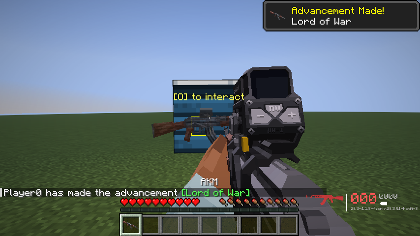
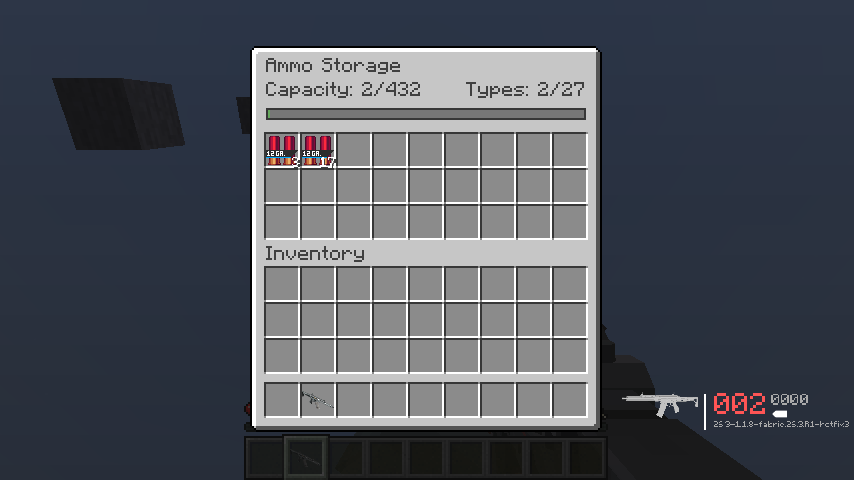
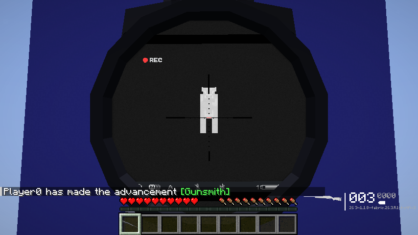
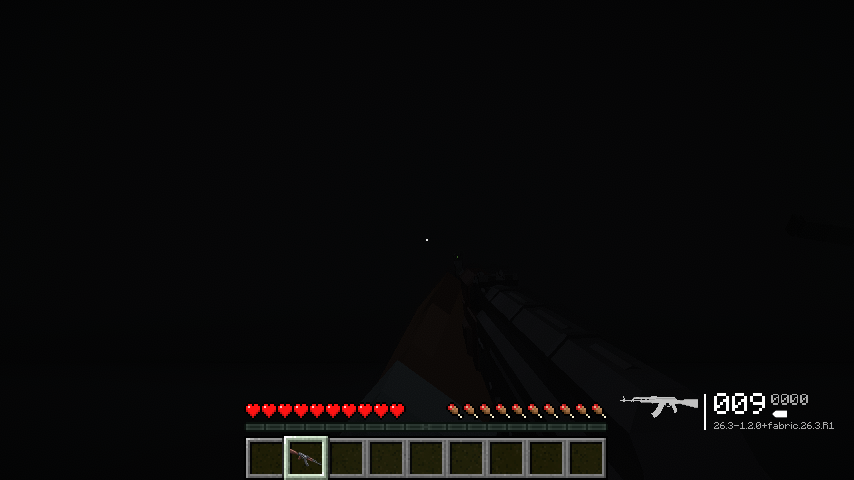
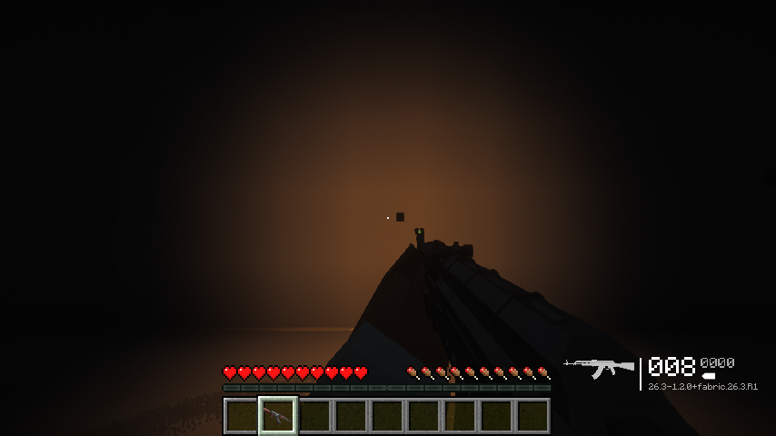
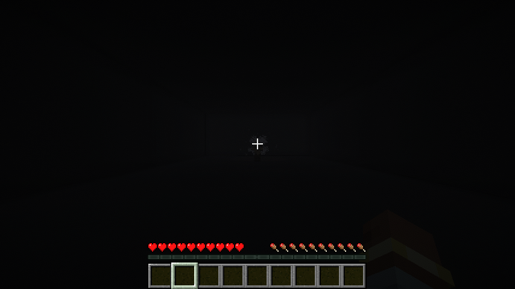
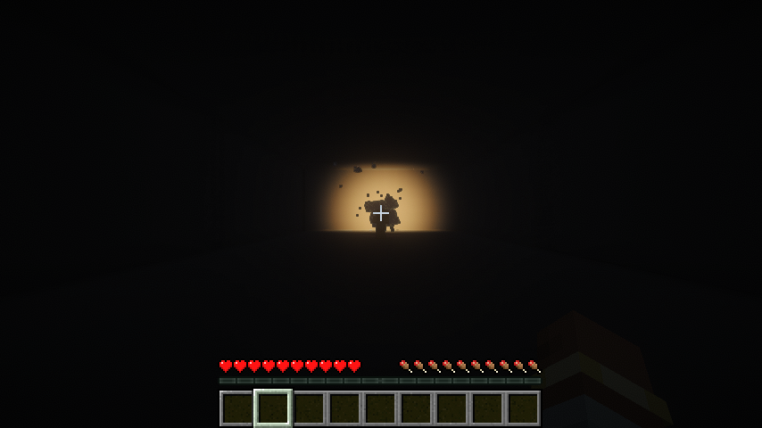

# TaCZ Refabricated — Unofficial Fabric Port

Build a gunsmithing table in survival, find the right parts for a gun and bring your own gun packs into Minecraft. This is a community port of **Timeless and Classics Guns: Zero (TaCZ)**. It is not an official TaCZ release or endorsed by the TACZ Dev Team.

### Pick the file for your game

In **Files**, match your **exact Minecraft version** and the **Fabric** loader. Install the matching **Fabric API** and **Forge Config API Port**. The four game versions use separate jars; do not install the Forge/NeoForge TaCZ jar alongside this one.

| Minecraft | Java | Which features are in my file? |
|---|---|---|
| **26.3** | **25** | The screenshots and highlights below show development of `1.2.0+fabric.26.3.R1`, including the PR #124 test build. The published **1.1.8 R1-hotfix3** file predates them. Check your file's changelog. |
| 26.2 / 26.1.2 | 25 | Separate builds and changelogs for each version. |
| 1.21.11 | 21 | Use the 1.21.11 build, not a 26.x jar. |

The port adapts pack loading, networking and scopes to Fabric. **TacZ Mesh Loader** is built in for supported high-poly models. It includes **part of LRTactical's data-driven framework**, not the full mod or its art collection.

### Inside the 26.3 development build

- **Craft and refit.** Get an iron block to unlock the gunsmithing table in the vanilla recipe book. Make the table in a **3×3 crafting grid**; use the dedicated benches for guns, attachments and ammunition. The expanded default catalog includes the QR-24, M1897, SVD and `.300 BLK`. Some optics need a riser; some guns offer factory parts without consuming an inventory item. Browse by pack or DMR category, or use JEI or REI to look up compatible parts and ammo in either direction.
- **Build a display wall.** Aim at an empty pegboard cell for a placement preview. Press the gun interaction key (**K** by default) to place a held gun. Rotate displays, dye boards or lock connected cases. Iron, gold and diamond ammo storage retains its contents through upgrades; use a typed ammo box to refill, or a held gun to pick up matching rounds.
- **Set up your view.** Hold a gun and open **Esc → TaCZ: View settings**. Move the first-person model, set a static or expanding crosshair, change its color or share a style. Give an entire category a ring, then override just the M320 with a ladder. Profiles stay with the local launcher account. This does not change the scope reticle or ballistics.
- **Use the optic your pack supplies.** The UH-1 shows range, the XM157 can mark a visible entity and the XL50 can show heat behind the lens, **not through solid walls**. Scope effects and experimental picture-in-picture zoom are separate; PIP is off by default. Pack-defined flash, detached smoke, tracers and animation particles also work independently. A flash hider can shrink the flash without turning off smoke.
- **See light where the event happens.** Open **Mod Menu → TaCZ → gear → Render** with Cloth Config installed. **Muzzle light on nearby surfaces** briefly lights the floor ahead and the walls to either side. **Explosion light on nearby surfaces** lights the area around the actual impact, not the launcher. Both are **off by default**. A third switch estimates gun/arm exposure for eligible old packs. These effects do not place light blocks, change damage or alter spawning. The pack's laser beam remains; there is **no additional impact dot**.
- **Keep distant drops visible.** If a gun has no usable pack LOD, a dropped copy can use its slot icon from **8 blocks** instead of drawing the full model. `DroppedGunSpriteDistance`: `0` includes drops at your feet, `-1` disables this fallback. No icon? The model stays 3D. Held guns and wall displays don't switch to the icon.
- **Controls and server rules.** Rebind actions to keys or mouse buttons; use **Alt + your reload key** or a dedicated binding to unload supported guns. Packs can change reload/aim transitions, cooling, movement on firing and sound. Servers can set rules for crawling, airborne spread, mob anger, friendly fire and breakable blocks. Optional Controllable and Player Animation Library integrations are separate from the base install.

### In-game screenshots · 26.3 development

| Pegboard: before placing the item | Ammo storage: two distinct stacks | XL50: visible heat source |
|---|---|---|
|  |  |  |

| Same scene, surface light off | Surface light on |
|---|---|
|  |  |
|  |  |

Earlier menu and pegboard frames show the build label and key binding of the capture. **Both shots in each lighting pair were fired.** Top: the near wall in front of the AK. Bottom: the wall around a rocket impact roughly 30 blocks from the observer. These pairs use **Complementary Reimagined r5.9.3**. The full gallery also has the no-shader pairs, recipe screens, HUD editor, third-person poses and the dropped-gun comparison.

### Packs and troubleshooting

- Put a trusted folder or ZIP in `.minecraft/tacz/`, with `gunpack.meta.json` at its root. `tacz_backup/` is for the legacy converter. On 26.3, admins can check a modern-layout 1.20.1 pack and **export a separate compatibility layer** without overwriting the source. A warning or a passed version check does not make every pack compatible. A pack requiring exactly `1.1.8` does not match `1.2.0`; encrypted assets requiring TacZ:Arcana are not supported.
- A missing **vanilla crafting recipe**, a locked **recipe-book entry** and an empty **TaCZ bench** are different problems. Update both ends on a server. REI keeps server crafting entries when pack data arrives late. For a blank bench, try an empty hand or clear the held-item filter. Same-ID filters from different packs now combine; blacklist-only rules no longer hide the entire list on the client. Explicit server exclusions still apply. A blank item obtained via a viewer's cheat action may instead lack its pack ID; compare it with a stack from a TaCZ creative tab.

### 中文说明

本项目是 TaCZ 的**非官方 Fabric 移植**。请在「Files」按 MC 版本选文件：26.3、26.2、26.1.2 用 Java 25，1.21.11 用 Java 21；都需要对应版本的 Fabric API 与 Forge Config API Port。上图是 **26.3 的 `1.2.0+fabric.26.3.R1` 开发／试玩构建**，不是已发布的 1.1.8 R1-hotfix3，也不是另外三条线的功能承诺。

- **制作、收纳与陈列：**取得铁块可解锁枪械制造台的原版 3×3 配方。枪、配件、弹药在各自的专用台制作；枪包同名过滤器合并，服主明确拉黑的仍不可用。可在创造栏按包筛选，用 JEI／REI 双向查适配。新默认包有 QR-24、SVD、.300 BLK 等；部分镜要先装增高座，虚拟原厂件不扣库存。弹药库可带库存升级；拿枪按 **K** 可取匹配弹药，也可把枪挂上空板。挂板可预览、旋转和染色，连柜可锁。
- **准星与镜片：**持枪按 **Esc → TaCZ 持枪与准星**，按本机账号设持枪位置、准星形状、颜色与开火开合，可分享；单枪覆盖类别，类别覆盖账号默认。UH-1 测距、XM157 镜内标记、XL50 白热各有用途；画中画另行开启，默认关。枪口焰随配件缩放，烟可单独关闭；另支持动画粒子和曳光。
- **补光与远景：**用 Mod Menu 与 Cloth Config 打开「TaCZ → 齿轮 → 渲染」，开启「枪口近场散射」看前方及两侧墙地，打开「爆炸近场散射」看真正爆点附近；旧枪／手曝光另有开关，三项默认都关。两列都真实击发，不改变世界光照或刷怪。**只去掉额外镭射落点，原光束保留。** 无作者低模的掉落枪默认从 8 格用槽位图；`0` 含脚边，`-1` 关闭，无图保留 3D，手持和陈列不变。
- **操作与装包：**可改键和鼠标侧键；支持的枪用 Alt + 换弹键卸弹。服主可设趴姿、空中散布、枪声引怪、队友及方块命中规则。普通枪包放 `.minecraft/tacz/`，ZIP 根部须有 `gunpack.meta.json`；转换可先检查、另导出。内置 TML 和部分 LRTactical，不代表旧版附属、加密包、每个光影或所有 1.2 枪包都可用。

### Guides, credits and support / 图文、署名与反馈

[Illustrated player guide / 玩家指南](https://github.com/q14433686-arch/TaCZ_Refabricated_Unofficial/blob/d70609fe4efe951e1412b7a85feafe7f317f1da3/docs/PLAYER_GUIDE_26_3.md) · [All screenshot sets / 完整图册](https://github.com/q14433686-arch/TaCZ_Refabricated_Unofficial/blob/d70609fe4efe951e1412b7a85feafe7f317f1da3/docs/SCREENSHOTS_26_3.md) · [Pack-author Wiki notes](https://github.com/q14433686-arch/TaCZ_Refabricated_Unofficial/blob/d70609fe4efe951e1412b7a85feafe7f317f1da3/docs/wiki/GUNPACK_26_3.md). Report port issues to [this project](https://github.com/q14433686-arch/TaCZ_Refabricated_Unofficial/issues), not the original authors. Include game/mod file, pack, steps and shader settings.

Original mod and default pack: [TACZ Dev Team](https://github.com/MCModderAnchor/TACZ). Direct Fabric upstream: [Sh1roCu](https://github.com/Sh1roCu/TACZ-Refabricated). TML: [VellEagle](https://github.com/VellEagle/TacZMeshLoader). Partial LRTactical code: LesRaisins. TaCZ port code: GPL-3.0. Default pack art, animation and audio: **CC BY-NC-ND 4.0**, not GPL. The bundled Mayday Animation Engine is MIT; the relocated SimpleBedrockModel particle/Molang code on the 26.3 development line is LGPL-3.0. [License notices / 许可说明](https://github.com/q14433686-arch/TaCZ_Refabricated_Unofficial/blob/d70609fe4efe951e1412b7a85feafe7f317f1da3/LICENSES.md).
