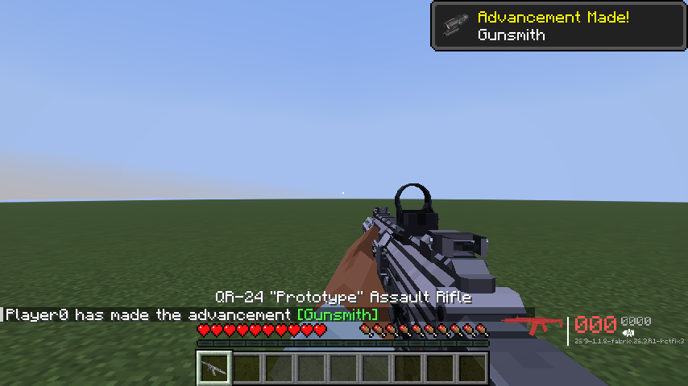
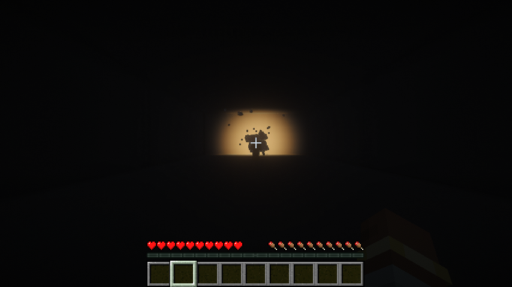

# Modrinth 发布文案

> 复制粘贴用。`[[ ]]` 里的内容**需你自己替换**，发布前搜 `[[` 全部处理掉。
> 所有规则依据均为 Modrinth 官方 [Content Rules](https://modrinth.com/legal/rules) 原文。

---

## ⚠️ 会导致驳回的硬性规则（务必先读）

| 规则原文 | 对我们的影响 |
|---|---|
| §5.2 **"Project titles are only the name of the project, without any other unnecessary filler data."** | **标题只能是项目名**，不能塞 `26.2`、`(Unofficial Port)` 这类附加信息 |
| §5.3 **"Project summaries contain a small summary... without any formatting and without repeating the project title."** | Summary **不能带 Markdown 格式**，**不能重复标题里的词** |
| §1.9 不得 **"Give the impression that they emanate from or are endorsed by... any other person or entity, if this is not the case."** | 必须明确「非官方、未获 TACZ 团队背书」，否则可能被判**冒充/误导** |
| §4 **"...it is a license-abiding 'fork'... We define 'forks' as modified copies of a project which have diverged substantially"** | 我们靠 **GPL-3.0 合规 fork** 这一条立足，描述里必须写明许可与来源 |
| §2.1 描述须回答：做什么 / 为何下载 / 下载前必须知道的关键信息 | 三点都要覆盖（下面文案已覆盖） |
| §5.6 **"All dependencies must be specified in the Dependencies section"** | 依赖必须填在 Dependencies 字段，**不能只写在描述里** |
| §5.1 metadata 须与别处**一致** | License / 环境 / 标签要和 GitHub、CurseForge 对得上 |

> **另注**：默认枪包资源是 `CC BY-NC-ND 4.0`（NC = 非商业），
> **[[ 必须到 Settings → Monetization 关闭货币化 ]]**。

---

## ① Project Title

```
[UNOFFICIAL]TaCZ Refabricated
```

> ✅ **无版本号** —— 这是 §5.2 真正要规避的 filler data。
>
> ✅ **`[UNOFFICIAL]` 前缀是有意保留的**，理由有三：
> 1. §5 前言原文写明这些条目 *"will not necessarily always be enforced"*
>    —— §5.2 属**软规则**（影响审核速度，不构成驳回理由）；
> 2. 它正面服务于 §1.9 这条**硬规则** —— 不得
>    *"give the impression that they... are endorsed by any other person or
>    entity, if this is not the case"*。标注 UNOFFICIAL 恰恰是在履行该条；
> 3. **实证先例**：Modrinth 线上项目
>    `[UNOFFICIAL] TaCZ 1.21.1 NeoForge Port`（49 万次下载）连版本号都带着，
>    至今正常在线。
>
> ❌ 不要加 `26.2` 或 `(Unofficial Port)` 这类后缀 —— 前者是版本号，
> 后者与前缀语义重复，都属真正意义上的 filler data。

---

## ② Summary（≤256 字符，纯文本无格式）

```
Craft guns at specialized workbenches, fit attachments and load community packs. Choose a separate file for each supported game version.
```

> 少于 256 字符。无 Markdown、不重复标题里的 "TaCZ Refabricated" —— 符合 §5.3。

---

## ③ Description

复制下面代码块里的 Markdown 到项目正文；每个文件的依赖与更新记录另填。原图与标题另见[Gallery 填写单](README.md#截图上传)。

```markdown
## Build a collection on Fabric

Make guns and attachments at dedicated workbenches, load community gun packs and use the parts your pack allows. This is an **unofficial** community port of *Timeless and Classics Guns: Zero*. It is not affiliated with, reviewed by or endorsed by the TACZ Dev Team.

### Maintenance and continuation

This project is **no longer actively maintained**. There is **no regular update schedule for any version**. **Minecraft 26.1.2 and 26.2 are archived**; their source and existing files remain available, but no further updates or fixes are planned. Only **1.21.11 and the latest version line** remain maintenance targets, with **occasional updates only** and no response, fix or porting deadlines. The latest port currently available in this project is **26.3**; unported Minecraft releases are not supported.

If you would like to continue maintaining the project, you are welcome to **fork it and maintain your own continuation**. Retain attribution and follow the existing code and asset licenses; this invitation does not grant additional rights to third-party assets.

### Choose the right version

Match the **exact Minecraft version** in Versions. Minecraft **26.3, 26.2 and 26.1.2 need Java 25**; **1.21.11 needs Java 21**. Each has its own Fabric jar and needs matching **Fabric API** and **Forge Config API Port**. The port adapts networking, resource loading and scopes to the target game. Supported high-poly packs can use the built-in TacZ Mesh Loader, and some LRTactical pack features are supported (not the entire mod).

### What's in the 26.3 development build?

These examples are from `1.2.0+fabric.26.3.R1`, including the PR #124 test build. They do **not** describe the published 1.1.8 R1-hotfix3 file or all four game versions.

- **Survival and storage.** Unlock the gunsmithing table recipe by picking up an iron block; craft it in the vanilla 3×3 grid. Guns, attachments and ammo have separate benches. The default pack includes the QR-24, M1897, SVD and .300 BLK, factory fittings and scope risers. Use JEI or REI for compatible ammo and attachments, or filter creative tabs by pack. A late pack refresh no longer clears ordinary server recipes from REI. Same-ID bench filters from different packs combine, including blacklist-only rules; server exclusions still apply.
- **Your collection on the wall.** Preview an item on a pegboard before placing it, turn it in its cell or lock connected cases. Keep ammunition in iron, gold or diamond storage and retain it when upgrading. Aim at storage with a gun and press the interaction key (default **K**) to take matching rounds. Actions can be rebound, including a separate unload key; Alt + the current reload binding also works for supported guns.
- **Your screen, not the server's.** While holding a gun, open **Esc → TaCZ: View settings** to move the first-person model and design, color or share a HUD reticle. A single-gun rule overrides a category, then your local account default. Try the M320 ladder without changing the RPG-7. UH-1 range text, XM157's in-scope marker and XL50 white-hot targets are separate optics features. Optional picture-in-picture zoom is off by default.
- **Shots and impacts.** Pack-defined flash, detached smoke, tracers and animation particles have distinct controls. In Render settings, optional **muzzle surface light** fans out onto the wall and floor in front of the shooter. **Explosion surface light** starts at the actual blast, even when the observer is far from it. Compare the [same display room with muzzle lighting off](https://raw.githubusercontent.com/q14433686-arch/TaCZ_Refabricated_Unofficial/6b1b58a836ee742ede45d18bfd7a44bce72125c1/build-reports/visual/44639006524-reimagined-act-tacz_surface_objects_off.png) and [on](https://raw.githubusercontent.com/q14433686-arch/TaCZ_Refabricated_Unofficial/6b1b58a836ee742ede45d18bfd7a44bce72125c1/build-reports/visual/44639006524-reimagined-act-tacz_surface_objects_on.png): the helmet and pegboard item brighten while the case item stays full-bright. The cyan drop is a test-pack icon. Both lighting options and the separate **old-pack exposure estimate** are off by default; they do not change world light levels or gameplay. The laser beam remains, without an extra projected dot.
- **Distant dropped guns.** Without a usable pack LOD, an actual drop can use its slot icon from **8 blocks**. Set `DroppedGunSpriteDistance` to `0` to include nearby drops or `-1` to opt out. No slot image means it stays 3D. Held and displayed items are unchanged.
- **Pack and server options.** Reload scripts, cooling in inventory, firing movement, mob anger, prone and airborne spread, breakable blocks and entity/team exclusions depend on the pack or server configuration. Optional Controllable input and PAL third-person poses are separate integrations, not required dependencies.





[Full screenshot gallery, with shader-off and light-off comparisons](https://github.com/q14433686-arch/TaCZ_Refabricated_Unofficial/blob/6b1b58a836ee742ede45d18bfd7a44bce72125c1/docs/SCREENSHOTS_26_3.md) · [Illustrated player guide](https://github.com/q14433686-arch/TaCZ_Refabricated_Unofficial/blob/6b1b58a836ee742ede45d18bfd7a44bce72125c1/docs/PLAYER_GUIDE_26_3.md) · [Pack-author Wiki notes](https://github.com/q14433686-arch/TaCZ_Refabricated_Unofficial/blob/6b1b58a836ee742ede45d18bfd7a44bce72125c1/docs/wiki/GUNPACK_26_3.md).

### Adding packs and getting help

Use `.minecraft/tacz/` for trusted pack ZIPs or folders with `gunpack.meta.json` at the root. The 26.3 converter can check a modern-layout 1.20.1 pack and export a separate compatibility layer. It doesn't overwrite the original or certify every pack. Packs requiring exactly `1.1.8` don't match `1.2.0`; encrypted assets requiring TacZ:Arcana are unsupported. For rendering options, use Mod Menu with Cloth Config; the HUD editor doesn't need either.

Can't find a recipe? Separate **manual 3×3 crafting**, **book unlock**, **dedicated bench** and **viewer lookup**. Clear the held-item filter in an empty bench. A blank item with a raw `item.tacz.*` name obtained through a viewer's cheat action can instead be missing its pack ID: compare with a stack from a TaCZ creative tab. On a dedicated server, use matching client/server versions. Report the file, pack ID and steps to reproduce to [this port's tracker](https://github.com/q14433686-arch/TaCZ_Refabricated_Unofficial/issues), not upstream.

### Credits and license

Original mod and default pack by the [TACZ Dev Team](https://github.com/MCModderAnchor/TACZ); direct Fabric port by [Sh1roCu](https://github.com/Sh1roCu/TACZ-Refabricated); TML by [VellEagle](https://github.com/VellEagle/TacZMeshLoader); LRTactical by LesRaisins. TaCZ port code is GPL-3.0. The default pack's models, textures, animations and audio are **CC BY-NC-ND 4.0**, not GPL. Bundled Mayday Animation Engine is MIT; the 26.3 particle/Molang source port from SimpleBedrockModel is LGPL-3.0. [License notices](https://github.com/q14433686-arch/TaCZ_Refabricated_Unofficial/blob/6b1b58a836ee742ede45d18bfd7a44bce72125c1/LICENSES.md).
```

---

## ④ 版本上传（Create version）

| 字段 | 填什么 |
|---|---|
| **Version name / number** | 按所上传 JAR 填完整版本；26.3 当前开发构建为 `1.2.0+fabric.26.3.R1`。更新项目介绍不上传文件。 |
| **Release channel** | 按文件的实际状态；CI 测试包不标为正式 Release。 |
| **Loaders** | `Fabric` |
| **Game versions** | 每个文件只勾选对应的 MC 版本。 |

### Dependencies（§5.6 强制要求填在此处）

| 项目 | 类型 |
|---|---|
| **Fabric API** | `Required` |
| **Forge Config API Port** | `Required` |

---

## ⑤ Changelog

本轮 26.3 单文件使用[开发测试说明](26.3-1.2.0-R1-notes.md)；以下各块是旧 **26.2** 文件／当时的草稿，不用来更新项目正文。

```markdown
Beta 3 Hotfix – public test build of this Fabric port.

Ported from the upstream Fabric project (`Sh1roCu/TACZ-Refabricated`),
based on TACZ `1.1.8-hotfix`.

### Highlights
- Fixed a long-standing viewmodel bug: while aiming-down-sights, firing or reloading
  made the whole gun body slide sideways by several degrees when facing the four
  diagonal headings (SE/NW drifted left, NE/SW right; vanilla renderer only — Iris
  shader packs were not affected). Root cause: the 26.2 vanilla hand pass premultiplies
  a per-facing camera base rotation that the ported ADS-constraint math did not
  neutralize; the anisotropic constraint coefficients were therefore rotated by that
  facing (R·diag·R leakage, ~sin(2·yaw)). The fix conjugates against the inverse base
  (Bᵀ·diag·Bᵀ), restoring exact 1.21.1 behavior in all 8 headings. Hip-fire and
  shader-pack rendering are unchanged.
- See-through scopes (offscreen-mask path): the gun body, non-scope attachments and
  both muzzle-flash layers (the main quad and the additive glow swirl) are now
  discarded inside the sight picture, so the world shows through the scope lens
  correctly (vanilla renderer). The glow layer replicates vanilla's 26.2
  energy_swirl setup (shared entity shader + APPLY_TEXTURE_MATRIX + additive
  blending) with the mask discard added on top, so its look is unchanged.
- Third-person gun animation: fixed a long-standing failure where switching guns
  once with Player Animation Library installed permanently killed all third-person
  gun animations for the session (a full world reload was required). Root cause is in
  PAL itself: its FADE_OUT modifier is never removed from the controller chain and
  zeroes out everything below it once finished; our stop path now uses a
  FADE_IN-to-null fade, which PAL removes correctly after completion. Gun switching,
  holstering and re-equipping now re-play animations as expected.
- Scope mask shape upgraded with an opt-out: the ocular mask is now the filled
  convex hull of the ocular projection (`ScopeMaskHullFill=true`), fixing sparse
  sliver-glass oculars (AUG built-in sight, Elcan slats) leaving scope-body
  fragments inside the lens. Set to false to instantly fall back to the legacy
  geometric projection.
### Notes
- Requires Java 25 and Forge Config API Port.
- Gun packs requiring TacZ:Arcana (encrypted assets) will show missing textures.

### Known issues
- Laser-sight recoloring works via vertex color on a vanilla emissive render type.
  Under an active Iris shader pack the pack decides whether that color is applied:
  minimal packs without colored-emissive support will keep the laser at its default
  color. This is a shader-pack limitation, not a GPU or driver issue.
- The ocular mask is now the filled convex hull of the ocular projection
  (ScopeMaskHullFill=true). On some scopes the hull can be slightly larger than
  the true aperture, nibbling the scope body's inner rim; if you see that, set
  ScopeMaskHullFill=false to fall back instantly and send us a screenshot with
  ScopeMaskDebug=true.
- PIP / second-world scope rendering is not enabled by default and remains paused.
- Under active Iris shader packs the in-lens masking stays in its safe fallback
  (scope tube interior visible inside the ocular).
- LRTactical is partially integrated; flash shield and some add-on systems are
  incomplete.

```

> **⚠️ 上面这块是已发布原文（留档勿动），但其中一条已经过时**：
> `PIP / second-world scope rendering is not enabled by default and remains paused.`
> —— PIP 早已实现，只是**默认关闭**、且现在是**游戏内配置界面里的开关**
> （Mod Menu → Timeless and Classics Guns → 齿轮 →「渲染」分类）。
> 下次发布**不要**把这句抄进新 changelog，用下面 ⑤-ter 的措辞。

---

## ⑤-bis 26.2 历史文件草稿（案例⑧ 正式修复 · 2026-08-12）

> **2026-08-31 注**：版本号已前进到 R3（GitHub/CurseForge 线上已到 R2-hotfix2）。
> 实际发布时以 `docs/archive/CHANGELOG_26_2_R2.md` 的 R3 段为准重写本块；
> 下方 R1 草稿保留为当时的行文范式参考。

> R1 发布时用本块替换线上 changelog；§⑤ 里的 Beta 3 Hotfix 块是已发布原文，留档勿动。

```markdown
R1 – first release build of this Fabric port.

### Fixes
- First-person ADS viewmodel: the diagonal-heading recoil fix shipped in
  Beta-3-Hotfix (2026-08-10) turned out to be defective. Its B^T*diag*B^T
  sandwich conjugated only the raw coefficient D = (ICAx-1, ICAy-1, 1-ICAz)
  and left the write-back sign flip Q = diag(-1,-1,+1) outside the frame
  transform; since Q does not commute with rotations, aiming down sights while
  reloading or firing made the whole arm+gun assembly rotate with the player's
  heading (north drifted left, west right, the gun ran backward when looking
  up/down, recoil over-pressed downward — everything normal only under Iris
  shader packs). The constraint translation now conjugates the true authored
  coefficient C = Q*D inside the live pose frame (v = (Q*W*Q)*D*Wᵀ*v0, W = the
  write-time pose rotation), matching 1.21.1 behavior in all eight headings:
  no heading-locked rotation, no diagonal-direction lateral leak, natural
  muzzle feel. Verified in-body on both 26.1.2 and 26.2. Instant fallback:
  ConstraintCompensateMode=0 restores the pre-fix plain form.
- See-through scopes: the physical ocular_ring (the black eyepiece rim present on all
  14 mid/high-magnification scopes of the default pack) is now drawn unclipped while
  aiming, mirroring upstream 1.21.1 stencil-ALWAYS handling — previously it rode the
  mask-clipped body batch, so the oculus mask nibbled its inner rim. Adapted for the
  26.2 mask architecture from the sibling 26.1.2 port's verified fix. Instant
  fallback: ScopeOcularRingFix=false.
- Low-power / red-dot sights (including the low-power side of combo scopes) no longer
  mask-clip the sight body, restoring upstream 1.21.1 renderSight semantics (the sight
  body is drawn unconditionally there). Our clip had been nibbling the sight's own
  inner frame since the scope-mask architecture landed. Instant fallback:
  ScopeSightClipFix=false.
- Player Animation Library, prone-dive exit: this build carries the sibling 26.1.2
  port's controller reset at the prone-to-standing edge (ported 1:1; it passed
  in-body verification on 26.1.2). On 26.2 the following remains a KNOWN ISSUE:
  in third person with PAL installed, after a prone cycle the arms can show a
  stale pose until the camera view is toggled; a prone cycle is required to
  trigger it, standing gun-switches alone do not. Cause not established —
  recorded as phenomenon only.
```

---

## ⑤-ter 26.2 历史文件草稿（R3 · 2026-09-02）

> 依据 `docs/archive/CHANGELOG_26_2_R2.md` 的 R3 段撰写，替换 ⑤-bis 的 R1 草稿。
> 标 *(Pending in-game verification)* 的两项**尚未实机验证**，发布前若已验证请
> 按 `AGENTS.md` §2 的措辞纪律改写或删掉；不要把它们写成已验证。

```markdown
R3 – test build of this Fabric port.

### Highlights
- **High-poly `mesh` guns now render in the world, not just in hand.** Guns from
  packs using the TacZ Mesh Loader format are baked on the GPU when held by other
  players, dropped, or displayed on item frames and pedestals, with a quantized
  lighting cache and a per-frame bake budget, so multiplayer scenes stop paying a
  per-vertex CPU transform cost. The baked detail gates are now scaled by the
  current aiming magnification, so a zoomed sight no longer drops a nearby mesh gun
  to a bare cube. *(Pending in-game verification; turning `MeshGpuWorld` off in the
  config screen returns to the previous behaviour.)*
- **In-game config saves again.** Settings changed in the config screen are written
  back to `config/tacz-client.toml`; a Forge Config API Port 26.x regression had
  left saves in memory only, so every setting reset on restart. Values already
  written into an older TOML file need to be changed and saved once to refresh.
- **Cross-pack crafting recipes load again.** Recipes converted to the newer
  `tacz:nbt` ingredient form (as produced by the community pack upgrader) were
  dropped outright, which showed up as "the addon pack's recipes neither appear nor
  craft". A dedicated ingredient type plus JSON normalisation fixes them, including
  the legacy `{item, nbt}` form whose NBT was silently discarded.
- **In-lens clipping now covers the arm, scope-mounted text and the crosshair**
  under shader packs, so mounted readouts (e.g. the MK5HD ammo counter) stay inside
  the ocular instead of drawing over the scope body.
- **Scope text content fixed:** packs that inline the display string into
  `text_key` (e.g. `%ammo_count%`) no longer show a `Format error:` prefix.
- **Inspect animations are interruptible again while aiming** (firing or reloading
  cancels them as expected).

### Notes
- Requires Java 25 and Forge Config API Port.
- Nearly every option lives in the in-game config screen (Mod Menu → Timeless and
  Classics Guns → gear icon). Only the debug keys and a few idle-release settings
  are TOML-only; `ScopePipShadowScale` additionally needs a restart or a dimension
  change, everything else applies on save.
- Gun packs requiring TacZ:Arcana (encrypted assets) will show missing textures.

### Known issues
- The optional **Scope PIP** in-lens renderer is **experimental and off by
  default**. It is switched on in the in-game config screen — not by editing files —
  and switching it off returns the game to the default rendering path.
- With `ScopePipRerender` on plus an active shader pack, expect roughly half the
  frame rate: the in-lens pass renders the world a second time.
- Mesh guns whose textures live in a `uv/` subfolder show a missing-texture sprite
  in the world (first person is unaffected). Known, not yet fixed; turning
  `MeshGpuWorld` off avoids it.
- Under active Iris shader packs the in-lens masking stays in its safe fallback
  (scope tube interior visible inside the ocular).
- LRTactical is partially integrated; flash shield and some add-on systems are
  incomplete.
```

---

## ⑥ 其他设置

- **Categories**：`Adventure`、`Equipment`
- **Environments**：`Client: Required`、`Server: Required`
- **License**：`GPL-3.0-only`
- **Links**：[Source](https://github.com/q14433686-arch/TaCZ_Refabricated_Unofficial) / [Issues](https://github.com/q14433686-arch/TaCZ_Refabricated_Unofficial/issues)。
- **Gallery**：每张图**都要有标题**。见[实图、标题与图注](README.md#截图上传)；不要把测试夹具当作默认美术。
- **Monetization**：**必须关闭**
